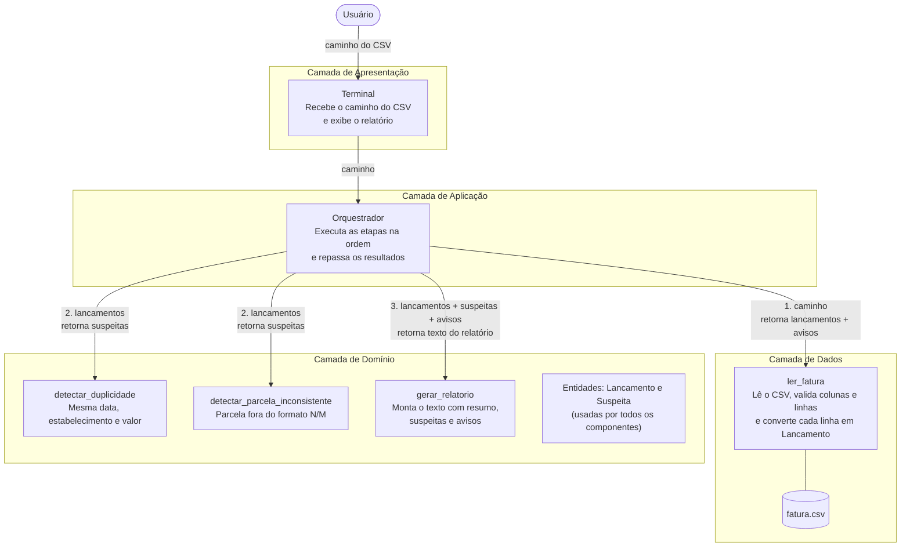

# Arquitetura do sistema

Estilo: arquitetura em camadas, em um único executável (monolítico). O fluxo segue em pipeline: o orquestrador chama cada etapa na ordem e repassa o resultado para a próxima.

## Diagrama

## Componentes e responsabilidades

| Camada | Componente | Responsabilidade | Recebe | Devolve |
|--------|------------|------------------|--------|---------|
| Apresentação | Terminal | Recebe o caminho do CSV e exibe o relatório | Caminho do arquivo | Relatório em texto |
| Aplicação | Orquestrador | Executa as etapas na ordem e repassa os resultados | Caminho do arquivo | Relatório em texto |
| Dados | `ler_fatura` | Lê o CSV, valida colunas e linhas e converte cada linha em `Lancamento` | Caminho do arquivo | Lançamentos e avisos |
| Domínio | `detectar_duplicidade` | Aponta lançamentos com mesma data, estabelecimento e valor | Lançamentos | Suspeitas |
| Domínio | `detectar_parcela_inconsistente` | Aponta parcelas fora do formato N/M | Lançamentos | Suspeitas |
| Domínio | `gerar_relatorio` | Monta o texto com resumo, suspeitas e avisos | Lançamentos, suspeitas e avisos | Texto do relatório |
| Domínio | `Lancamento` e `Suspeita` | Entidades compartilhadas entre os componentes | - | - |

## Comunicação

1. O orquestrador chama `ler_fatura` e recebe `(lancamentos, avisos)`.
2. Se o arquivo for aceito, chama os dois detectores com os lançamentos e junta as suspeitas.
3. Chama `gerar_relatorio` com lançamentos, suspeitas e avisos e entrega o texto ao terminal.

As camadas são lógicas (classes e funções dentro do mesmo arquivo `.py`), pois a entrega final tem um único arquivo de código.
