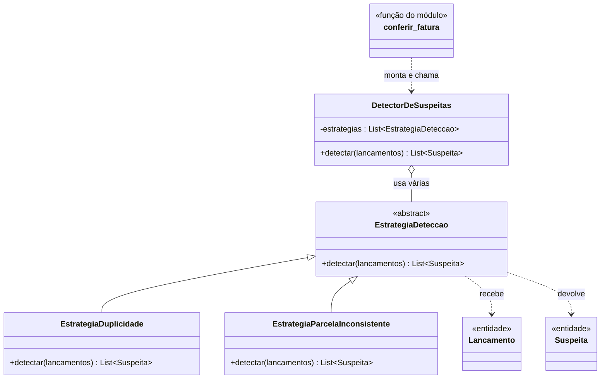
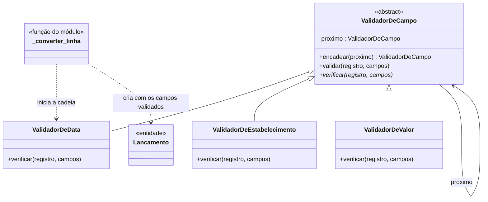
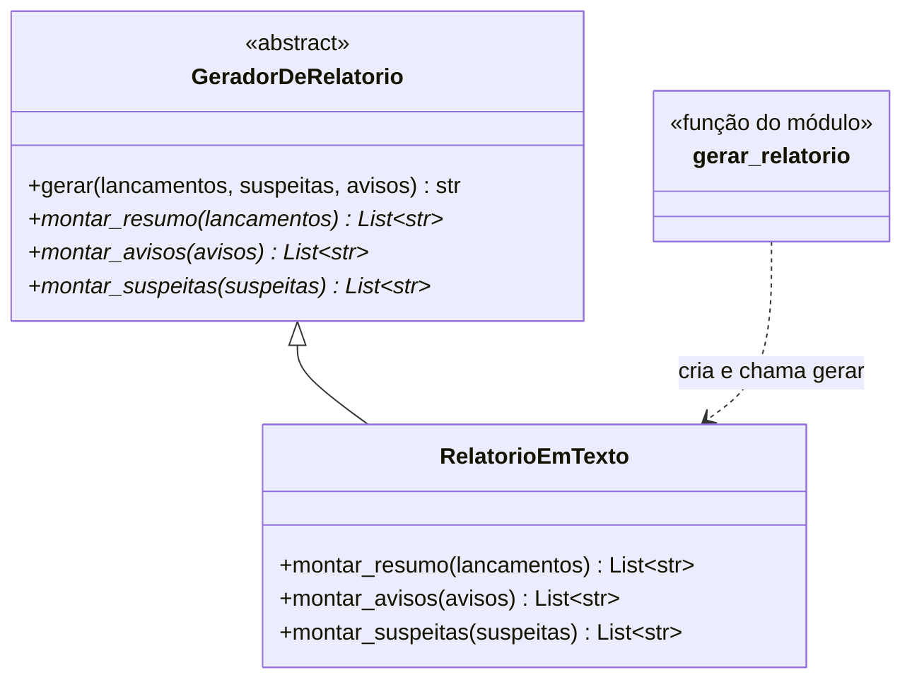

# Sprint 4: padrões de projeto aplicados

A refatoração aplicou três padrões no `conferidor_fatura.py`, sem mudar o comportamento: os mesmos 9 testes passam sem alteração, e a saída do programa é idêntica à da versão anterior (commit `bf8aec9`) nos 6 CSVs de `exemplos/` e em outros 3 arquivos de teste com erros. As funções `ler_fatura`, `detectar_duplicidade`, `detectar_parcela_inconsistente` e `gerar_relatorio` continuaram existindo e agora chamam as classes novas por dentro.

| Padrão | Camada | Classes | Autoria |
|---|---|---|---|
| Strategy | Domínio (História 2) | `EstrategiaDeteccao`, `EstrategiaDuplicidade`, `EstrategiaParcelaInconsistente`, `DetectorDeSuspeitas` | Eric |
| Chain of Responsibility | Dados (História 1) | `ValidadorDeCampo`, `ValidadorDeData`, `ValidadorDeEstabelecimento`, `ValidadorDeValor` | Iago |
| Template Method | Domínio (História 3) | `GeradorDeRelatorio`, `RelatorioEmTexto` | Ives |

## 1. Strategy: regras de detecção

**Onde:** seção "detecção de suspeitas" do `conferidor_fatura.py`.

**Problema antes:** `conferir_fatura` chamava as duas funções de detecção direto, então incluir uma regra nova exigia editar o orquestrador.

**Solução:** cada regra virou uma classe com a mesma interface (`detectar`). O `DetectorDeSuspeitas` recebe uma lista de estratégias e junta o resultado de todas. `conferir_fatura` monta o detector com `EstrategiaDuplicidade` e `EstrategiaParcelaInconsistente`.

**Ganho:** uma regra nova (por exemplo, valor muito acima da média) é uma nova subclasse de `EstrategiaDeteccao` incluída na lista, sem alterar as regras existentes nem o `DetectorDeSuspeitas`.

## 2. Chain of Responsibility: validação de cada linha do CSV

**Onde:** seção "leitura e validação do CSV", usada por `_converter_linha`.

**Problema antes:** `_converter_linha` validava data, estabelecimento e valor num bloco único, que crescia a cada regra nova.

**Solução:** cada checagem virou um elo (`ValidadorDeData`, `ValidadorDeEstabelecimento`, `ValidadorDeValor`). A cadeia é montada em `_montar_cadeia_de_validacao`, na ordem data, estabelecimento, valor. Cada elo confere o seu campo e guarda o valor já convertido; se o campo for inválido, levanta `ValueError` e a cadeia para ali. Se for válido, passa a linha para o próximo elo.

**Ganho:** incluir, retirar ou reordenar uma validação é mexer só na montagem da cadeia. Cada regra fica numa classe pequena.

## 3. Template Method: geração do relatório

**Onde:** seção "relatório" do `conferidor_fatura.py`.

**Problema antes:** `gerar_relatorio` era uma função única que misturava a ordem das seções com o texto de cada uma.

**Solução:** `GeradorDeRelatorio.gerar` é o método-molde: fixa a ordem (resumo, avisos só se houver, suspeitas) e chama três passos abstratos. `RelatorioEmTexto` preenche cada passo com o texto que já existia.

**Ganho:** um relatório em outro formato, como um resumido ou em HTML, seria uma nova subclasse que preenche os três passos, sem repetir a ordem das seções. Hoje existe uma só subclasse, então o padrão prepara a extensão.

Nos diagramas, o asterisco indica método abstrato e o sinal de menos indica atributo privado.
